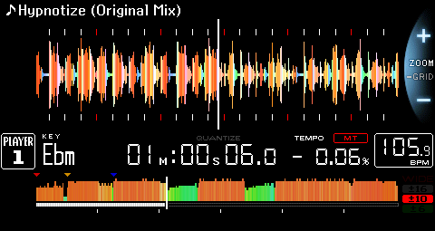

# CDJ-2000NXS: tall colour waveform with Serato DJ

A firmware patch for the **Pioneer CDJ-2000NXS** and a companion library for **Serato DJ Pro** on
macOS. In HID mode (player controlled by Serato), the player's screen shows the large colour
waveform, as tall as in USB mode, with the beat grid, hot cues and loops.



*Screenshots taken in an emulator of the player.*

> [!CAUTION]
> **Use at your own risk.** This project modifies your player's firmware. Flashing modified
> firmware can permanently damage ("brick") your player, and voids its warranty. You alone decide
> to install it, and you alone are responsible for the consequences. The software is provided
> "as is", without any warranty. The author accepts no liability for any damage to your equipment,
> your data or your performance. See [Disclaimer](#disclaimer).

*Résumé en français à la fin.*

## What it does

With Serato in HID mode, the stock player only shows a logo and a small waveform. With this
project:

- **Large colour waveform** at the top of the screen, as tall as in USB mode, computed from the
  audio file of the track loaded in Serato.
- Serato's **beat grid**, **hot cues** and **loops** tracked live: loop mask, loop points adjusted
  with the jog wheel, ÷2 / ×2.
- **Small waveform** at the bottom in colour.
- **Zoom** of the large waveform with the rotary selector, in track view.
- **Rotary selector**: one track per detent in Serato's lists.
- **Two patched players** at the same time. A stock player connected alongside ignores the added
  packets (tested in the emulator only).
- **USB mode** (rekordbox drives) is unchanged.

## Requirements

- A **CDJ-2000NXS** (not the NXS2) running **firmware 1.44**.
- A **Mac** running macOS 11 or later.
  - Tested on Apple Silicon with macOS 26.6.
  - The library also contains an Intel build, which has never been tested.
- **Serato DJ Pro** installed in `/Applications`. Tested version: 4.0.0 (build 2697).
- **Python 3**, to build the firmware. It comes with Xcode's command line tools
  (`xcode-select --install`).
- Two **FAT32** USB drives.
- Tracks stored as files on the Mac (MP3, WAV, AIFF, FLAC, M4A). Streaming tracks have no file:
  they are displayed as on a stock player.

## 1. Build the firmware

This repository contains no Pioneer firmware. You build the patched firmware on your own Mac,
from the official firmware.

1. Download firmware **1.44** for the CDJ-2000NXS from the Pioneer DJ website (CDJ-2000NXS
   support page). You get `CDJ2000NXS_v144.zip`.
2. Run the tool from the repository folder:

   ```bash
   python3 firmware/patcher.py ~/Downloads/CDJ2000NXS_v144.zip
   ```

The tool checks that the input is the official 1.44 firmware, then writes:

| File | Purpose |
|---|---|
| `sortie/PATCH/C2KNXS.UPD` | firmware 1.44 with the patch |
| `sortie/RESTAURATION/C2KNXS.UPD` | stock firmware 1.44, to go back |

Both are numbered 9.99, so the player accepts them whatever its current version. The tool checks
each result against its expected fingerprint: if anything differs, it writes nothing.

Expected SHA-256 values:

```
1cad6de57325644846b123d7935d7dca2c82bd618bd1ed1d58aefaedb355b462  PATCH/C2KNXS.UPD
cf44b9b13b7acc9c123c3ef1d0dcd87640c40a078fa528cba0f5f064b9f49bd6  RESTAURATION/C2KNXS.UPD
```

## 2. Flash the player

> [!WARNING]
> **Never cut the power during the update.** A power loss while flashing can leave the player
> unusable. Have the RESTAURATION drive ready before you start.

1. Prepare two FAT32 USB drives, named "PATCH" and "RESTAURATION".
2. Copy each `C2KNXS.UPD` to the **root** of its drive, **without renaming it**.
3. Check the copies: the fingerprints must match the values above.

   ```bash
   shasum -a 256 /Volumes/PATCH/C2KNXS.UPD /Volumes/RESTAURATION/C2KNXS.UPD
   ```

4. Eject the drives properly. Keep the RESTAURATION drive at hand.
5. With the player off, switch it on while holding **USB** and **RELOOP/EXIT**. Plug in the
   PATCH drive when the screen asks for it. Wait for the progress bar to finish, switch the player
   off, and remove the drive.
6. Check USB mode with a rekordbox drive: the screen starts, the waveform is blue and scrolls, and
   the grid, zoom, cue and loops work, with no error message.
   - UTILITY still shows 1.44: this is the internal version of the program, which is normal.
   - If anything is wrong, flash the RESTAURATION drive the same way.

## 3. Install the Mac part

1. Download the repository (**Code → Download ZIP** on GitHub, or `git clone`) and put it, for
   example, in `Documents`.
2. Remove the quarantine flag that macOS sets on downloaded files. Without this, macOS may refuse
   to load the library:

   ```bash
   xattr -dr com.apple.quarantine ~/Documents/cdj2000nxs-serato-hd
   ```

3. Check that Serato accepts an added library:

   ```bash
   codesign -dv "/Applications/Serato DJ Pro.app" 2>&1 | grep flags
   ```

   - `flags=0x2(adhoc)`: fine. This is the case for Serato DJ Pro 4.0.0 as installed.
   - If the word `runtime` appears, macOS will silently ignore the library. This case has not been
     tested.

4. Optional: rebuild the library (requires Xcode's tools):

   ```bash
   ~/Documents/cdj2000nxs-serato-hd/mac/build.sh
   ```

The Mac part installs nothing on the system: neither macOS nor Serato is modified. Serato started
the usual way (Dock, Finder) stays the stock Serato.

## 4. Play

1. Quit Serato (Cmd+Q).
2. Start Serato with the Mac part:

   ```bash
   ~/Documents/cdj2000nxs-serato-hd/serato-hd.sh
   ```

   - The Terminal stays busy while Serato is open.
   - On first launch, macOS may ask to give **Terminal** access to your music folders or to the
     microphone: accept, otherwise Serato will not see your tracks.
3. On each player: LINK → CONTROL MODE → USB MIDI.

Double-click shortcut: copy `serato-hd.sh` to `Serato HD.command`. Double-clicking it in the
Finder opens the Terminal and starts Serato with the Mac part.

Each session writes two files in `captures/`: a log (`.log`) and a recording of the exchanges
with the players (`.rec`, 5 to 15 MB for 10 minutes). You can delete them at any time.

## Going back

- **Mac part**: delete the repository folder. There is nothing else to remove.
- **Player**: flash the RESTAURATION drive. The player goes back to the stock 1.44 firmware.
- Without the Mac part, a patched player works in Serato like a stock player (logo, small
  waveform). Only the rotary selector keeps moving one track per detent.

## Known limitations

- The Mac part finds a track's file by its name, or by the title stored in the file. It then
  checks that its duration matches the one Serato reports. If it does not find the file, the
  player shows the track as on a stock player: it never shows another track's waveform.
- Tracks must be analysed by Serato to get the beat grid.
- Loops are tracked from what Serato sends to the player. With the same track on both players,
  Serato sometimes takes one player out of its loop when a loop is set on the other one. The mask
  then stays on the old loop.
- Tested with a single version of each part: CDJ-2000NXS 1.44, Serato DJ Pro 4.0.0, macOS 26.6
  on Apple Silicon.
- The patch does not touch the player's boot loader or its backup program image, but no failure
  case could be tested.

## How it works

- **Firmware** (`firmware/patch/`): code added to the player's two processors.
  - `hdwave.c` (main processor, SH-4) receives new HID packets from Serato and handles the rotary
    selector.
  - `rgbwave.c` (display processor, Blackfin) draws the colour waveform, the grid, the cue points
    and the loop mask.
  - `build.py` and `build_gui.py` list where this code is hooked into the stock firmware. Each
    location is checked before it is modified.
- **Mac** (`mac/`): `serato_hd.dylib` is loaded into Serato at launch. It finds the track loaded
  on each player, analyses its audio file (`hdcore.c`), sends the compressed waveform and the grid
  to the player, then tracks hot cues and loops.

Source comments are in French.

### Rebuilding the firmware

The firmware is rebuilt with two cross-compilers, `sh-elf-gcc` and `bfin-elf-gcc`, expected in
`ext/toolchain/` next to the repository. To build update files from your own binaries, see
`firmware/patch/build.py`. The `patcher.py` tool uses the prebuilt binaries in
`firmware/binaires/`.

## Disclaimer

- **You use this project entirely at your own risk.** Flashing modified firmware can permanently
  damage your player. A power cut, a faulty USB drive or an unforeseen bug can make it unusable.
- Installing modified firmware **voids the manufacturer's warranty**.
- The software is provided **"as is", without warranty of any kind**, express or implied. The
  author shall not be liable for any damage to your equipment, loss of data, or failure during a
  performance, whatever the cause.
- Test it at home, over a long session, before using it in front of an audience. Always keep a
  stock player or the RESTAURATION drive within reach.
- This project is **not affiliated with, endorsed or supported by Pioneer DJ / AlphaTheta or
  Serato**. Product names are used only to describe what this project works with. Do not contact
  their support about problems caused by this project.

## Acknowledgements

- The **LNNRT** mods for the CDJ-2000NXS served as a reference for the update file format. None
  of their code is used here.
- The open source **Pioneer CDJ & XDJ Emulator** (QEMU, GPL-2.0) was used to test every version
  before flashing it.

## Licence

[MIT](LICENSE). The licence covers this repository only, not Pioneer's firmware.

---

## Résumé en français

Patch de firmware pour le **Pioneer CDJ-2000NXS** (firmware 1.44) et bibliothèque pour **Serato
DJ Pro** sur Mac. En mode HID, l'écran de la platine affiche la grande waveform en couleur, aussi
haute qu'en mode USB, avec la grille de Serato, les hot cues et les boucles. Le mode USB est
inchangé.

> [!CAUTION]
> **À tes propres risques.** Flasher un firmware modifié peut rendre la platine définitivement
> inutilisable et fait perdre la garantie. Le logiciel est fourni « tel quel », sans aucune
> garantie. L'auteur n'est responsable d'aucun dommage, ni au matériel, ni aux données, ni pendant
> une prestation. Ne coupe jamais l'alimentation pendant une mise à jour.

- Ce dépôt ne contient **aucun firmware de Pioneer**. Télécharge le firmware officiel 1.44 sur le
  site de Pioneer DJ, puis lance `python3 firmware/patcher.py CDJ2000NXS_v144.zip`. L'outil
  vérifie le fichier et écrit un firmware patché (`sortie/PATCH`) et un firmware de restauration
  (`sortie/RESTAURATION`), tous deux numérotés 9.99. Les empreintes attendues sont données plus
  haut.
- Flashage : chaque `C2KNXS.UPD` à la racine d'une clé FAT32, sans le renommer. Platine éteinte,
  allume-la en maintenant **USB** et **RELOOP/EXIT**, puis branche la clé quand l'écran le demande.
- Mac : retire la quarantaine (`xattr -dr com.apple.quarantine <dossier>`), puis lance Serato avec
  `./serato-hd.sh`. Rien n'est installé dans le système. Sur chaque platine : LINK → CONTROL MODE →
  USB MIDI.
- Retour en arrière : flashe la clé RESTAURATION, et supprime le dossier du dépôt.
- Essayé uniquement avec CDJ-2000NXS 1.44, Serato DJ Pro 4.0.0 et macOS 26.6 sur Apple Silicon.
- Projet sans lien avec Pioneer DJ / AlphaTheta ni Serato.
- Licence MIT (voir [LICENSE](LICENSE)) : elle ne couvre que ce dépôt, pas le firmware de Pioneer.
